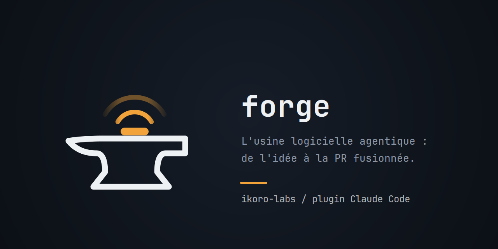
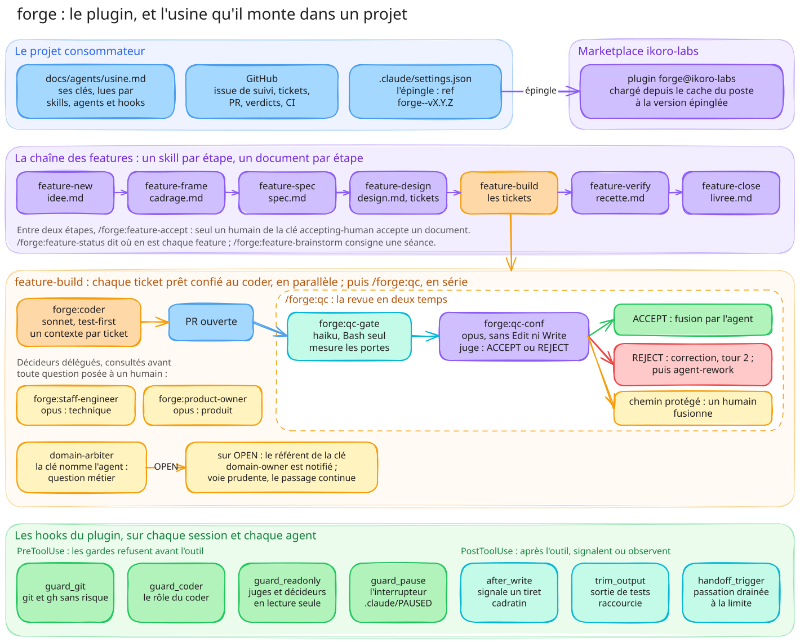

# forge



Un plugin Claude Code qui fait travailler une équipe d'agents sur un projet, de l'idée d'une
feature jusqu'à la PR fusionnée. Les humains n'interviennent qu'aux points de validation :
accepter un document, trancher une question qu'aucun agent n'a le droit de trancher.

Chaque projet installe forge à une version épinglée et garde chez lui ce qui lui est propre : sa
configuration, ses règles, ses skills de domaine.



## Comment ça marche

1. **On écrit la feature.** Une idée (`/forge:feature-new`) devient un cadrage, une spec puis un
   design, chacun écrit par un skill et accepté par un humain avec `/forge:feature-accept`. Le
   design accepté est découpé en tickets, par le skill de découpage du projet ou à la main.
2. **Un agent code chaque ticket.** `/forge:feature-build` confie chaque ticket prêt à
   `forge:coder`, qui le code en test-first dans son worktree jusqu'à une PR, en parallèle quand
   les tickets ne dépendent pas les uns des autres.
3. **Deux agents relisent la PR.** `/forge:qc` lance `forge:qc-gate`, qui rejoue la CI et mesure
   sans donner d'avis, puis `forge:qc-conf`, qui juge le diff contre le ticket et rend ACCEPT ou
   REJECT. Une PR acceptée est fusionnée, sauf si elle touche un chemin protégé (clé
   `protected-path`) ou retire un droit que le projet déclare (clé `never-weaken` : une ligne
   retirée, un nombre relevé, un rang abaissé) : un humain la fusionne alors. Une PR refusée
   retourne au coder pour un second tour.
4. **On vérifie et on clôt.** `/forge:feature-verify` relie chaque critère d'acceptation au test
   qui le prouve, `/forge:feature-close` écrit ce qui a été livré.

Une question technique ou produit en chemin va d'abord à `forge:staff-engineer` ou à
`forge:product-owner`, qui la tranchent selon la matrice des droits de décision du projet, ou
disent qu'elle revient à un humain. Des hooks gardent le tout : aucun agent ne pousse sur `main`,
ne fusionne une PR rouge, ou ne sort de son rôle.

## Ce que le plugin apporte

| Agent | Rôle |
| --- | --- |
| `forge:coder` | code un ticket jusqu'à une PR ouverte, sans la relire ni la fusionner |
| `forge:qc-gate` | rejoue les portes d'une PR (CI, tests, checks) et rend un tableau de mesures |
| `forge:qc-conf` | juge une PR : ACCEPT ou REJECT |
| `forge:staff-engineer` | tranche une question technique ou de gouvernance |
| `forge:product-owner` | tranche une question produit |

| Skills | Pour |
| --- | --- |
| `/forge:feature-new`, `-brainstorm`, `-frame`, `-spec`, `-design` | écrire une feature, de l'idée aux tickets |
| `/forge:feature-accept` | accepter un document, geste réservé à un humain |
| `/forge:feature-build`, `/forge:qc` | coder les tickets, relire et fusionner les PR |
| `/forge:feature-verify`, `-close`, `-status` | la recette, la clôture, et où en est chaque feature |
| `/forge:audit-jetons` | compter les jetons dépensés par chaque rôle |
| `/forge:slo` | le rapport des objectifs de service : valeur, budget d'erreur restant, état, tendance |
| `/forge:tdd` | ce qu'est un bon test, les coutures, les anti-patterns, la boucle et les mocks |
| `/forge:codebase-design`, `/forge:domain-modeling`, `/forge:improve-codebase-architecture` | le vocabulaire de conception que partagent les rôles |

<a id="ce-que-les-hooks-gardent"></a>

| Hook | Ce qu'il garde |
| --- | --- |
| `guard_git` | pas de commit ni de push sur `main`, pas de `--force`, pas de fusion d'une PR dont un check n'est pas vert, pas de geste du propriétaire du dépôt (runners, protection, collaborateurs, secrets, visibilité) |
| `guard_coder` | le coder ne fusionne pas, ne relit pas, ne ferme pas de ticket, n'écrit que dans son worktree, ne pousse ni avec `-u` ni avec `-f` |
| `guard_readonly` | les juges et les décideurs lisent, n'écrivent jamais |
| `guard_pause` | tant que `.claude/PAUSED` existe, aucun agent n'est lancé |
| `after_write` | formate chaque fichier écrit avec les formateurs que le projet déclare (clé `format-on-write`), puis refuse le tiret cadratin au-delà de ce que le projet admet |
| `trim_output` | la longue sortie d'une commande de tests qui réussit est raccourcie, la sortie complète gardée dans un journal |
| `sessions_notice`, `handoff_*` | une seule session par dépôt, et la passation à une nouvelle session quand le contexte est plein |

## Prérequis

- Claude Code.
- [uv](https://docs.astral.sh/uv/) : chaque hook se lance par `uv run`. Sans lui, les gardes ne
  s'appliquent pas, sauf ceux des agents, qui refusent alors chaque appel qu'ils filtrent.
- [gh](https://cli.github.com/), authentifié : la revue et la chaîne des features passent par lui.

## Installer dans un projet

1. Épingler forge dans le `.claude/settings.json` du projet, par une PR :

   ```json
   {
     "enabledPlugins": { "forge@ikoro-labs": true },
     "extraKnownMarketplaces": {
       "ikoro-labs": {
         "source": { "source": "github", "repo": "ikoro-labs/forge", "ref": "forge--v1.5.0" }
       }
     }
   }
   ```

2. Ouvrir une session dans le projet et approuver le dossier.
3. Installer, une fois par poste, depuis la racine du projet :

   ```sh
   claude plugin marketplace add ikoro-labs/forge@forge--v1.5.0 --scope project
   claude plugin install forge@ikoro-labs --scope project
   ```

4. Copier `plugins/forge/templates/usine.md` vers `docs/agents/usine.md` et le remplir (voir
   [Configurer](#configurer)).

Pour **monter de version** : une PR du projet change le `ref`, puis chaque poste lance, depuis la
racine du projet, jamais pendant un `/forge:feature-build` en cours :

```sh
claude plugin marketplace add ikoro-labs/forge@<nouveau tag> --scope project
claude plugin update forge@ikoro-labs --scope project
```

Le pourquoi de chaque étape, la vérification et les pièges (une seule source de marketplace par
poste) : [`docs/installation.md`](docs/installation.md).

## Configurer

Un projet décrit son usine dans un seul fichier, `docs/agents/usine.md` : qui accepte, la matrice
de décision, les commandes de la CI, les checks obligatoires, la grille de revue, les chemins
protégés. Le gabarit, [`plugins/forge/templates/usine.md`](plugins/forge/templates/usine.md),
documente chaque clé.

Une clé absente ne prend jamais de valeur par défaut : l'étape qui la lit se dit « sans objet »,
jamais `PASS`. Une revue vaut donc ce que la configuration déclare.

Pour adapter forge sans toucher au plugin, le projet ajoute ses propres skills, agents et hooks
dans son `.claude/` : ils coexistent avec ceux de forge, dont les noms sont préfixés (`forge:`).
Le cache du plugin ne s'édite jamais.

## Limites connues

Une seule source de marketplace par poste, la dépendance à GitHub, les noms préfixés, les champs
du front matter qu'un agent de plugin ignore : le détail est dans
[`docs/installation.md`](docs/installation.md#limites-connues).

## Aller plus loin

| Page | Contenu |
| --- | --- |
| [`docs/installation.md`](docs/installation.md) | l'installation pas à pas, les montées de version, les gestes humains, les limites connues |
| [`docs/sessions.md`](docs/sessions.md) | une session par dépôt, la passation drainée, les variables et les codes du relais |
| [`docs/modeles-et-jetons.md`](docs/modeles-et-jetons.md) | le modèle et l'effort de chaque rôle, un autre fournisseur, l'audit des jetons, les sorties raccourcies |
| [`docs/indicateurs-de-service.md`](docs/indicateurs-de-service.md) | les indicateurs de service de l'usine (SLI), calculés sans modèle, et leurs objectifs (SLO) avec leur budget d'erreur |
| [`docs/contribuer.md`](docs/contribuer.md) | modifier le plugin, publier une version, l'organisation du dépôt |
| [`CHANGELOG.md`](CHANGELOG.md) | ce qui est entré dans chaque version, et ce qui en est resté dehors |

Chaque page dit ce qui a été éprouvé sur un vrai poste, et ce qui n'a tourné que dans les tests.

## Licence

MIT ([`LICENSE`](LICENSE)). Trois skills adaptent mattpocock/skills sous licence MIT :
[`plugins/forge/THIRD_PARTY_NOTICES.md`](plugins/forge/THIRD_PARTY_NOTICES.md).
